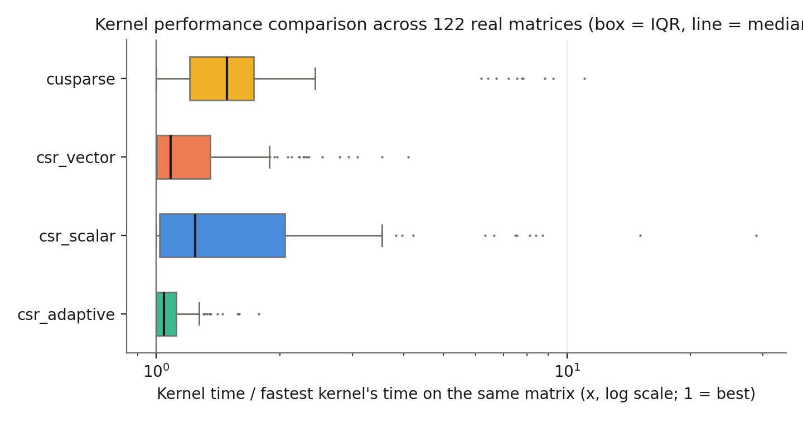
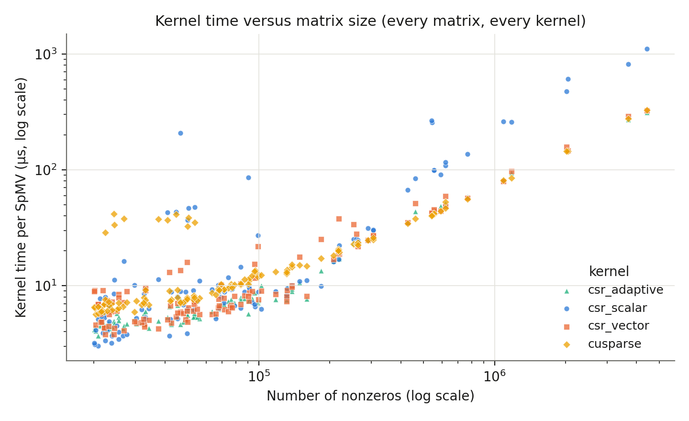
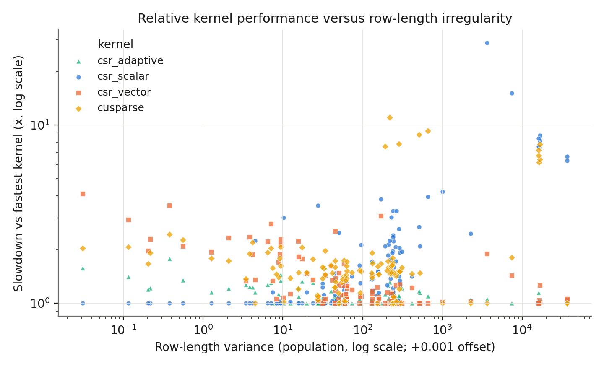
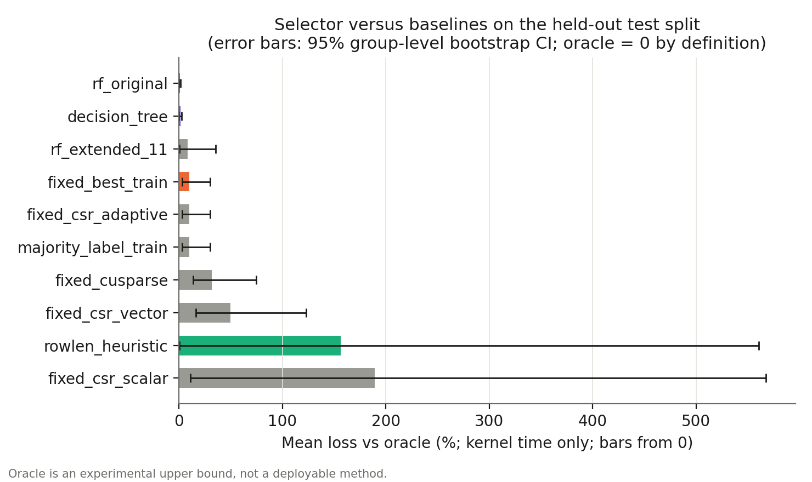
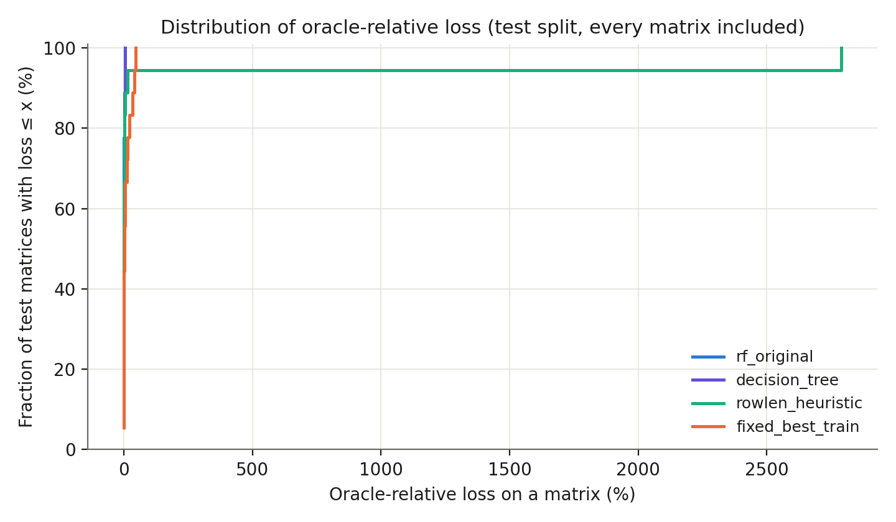
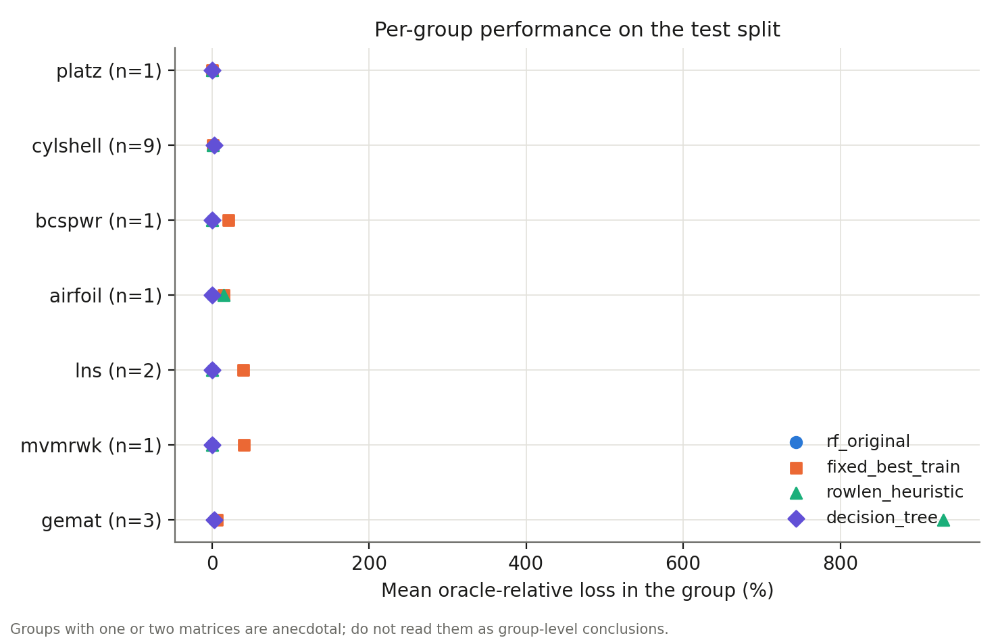
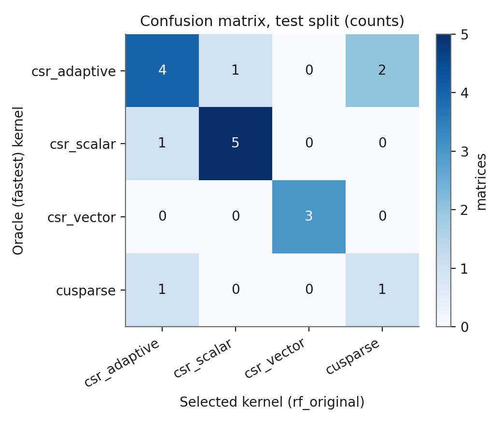
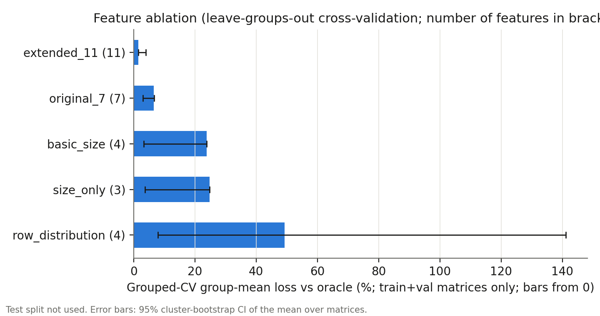
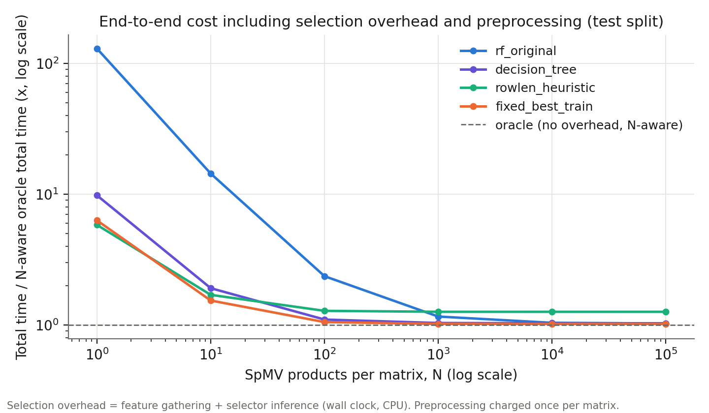
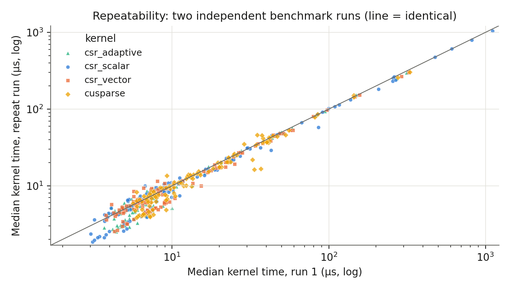

# Experiment report: `run_real_001`

> Auto-generated from recorded tables. Interpretation: `docs/results.md`. The oracle is an experimental upper bound, not a deployable method. Matrices of one group are not independent; with so few groups, intervals are wide and differences are rarely distinguishable from chance.

## 1. Data

* Matrices (after duplicate-pattern removal): train 86 (8 groups), validation 18 (8 groups), test 18 (7 groups); test matrices scored: 18.
* Kernels: csr_adaptive, csr_scalar, csr_vector, cusparse. Best fixed kernel on TRAIN: `csr_adaptive`.
* Tie tolerance (measurement-based, train+val only; median run-to-run difference of medians (train+val)): **8%**. Other noise statistics: median relative IQR of the winner 20.14%, run-to-run median difference 7.06% (90th percentile 36.97%).
* Row-length heuristic learned on train: `mean_row_nnz in (-inf, 15.1] -> csr_scalar; mean_row_nnz in (15.1, 63.3] -> csr_adaptive; mean_row_nnz in (63.3, inf] -> cusparse`.

## 2. Experiment 1: kernel characterisation (all matrices, descriptive)

| kernel | wins | median_ms | geomean_slowdown_vs_best | geomean_speedup_vs_cusparse |
|---|---|---|---|---|
| csr_adaptive | 46 | 0.006771 | 1.085 | 1.499 |
| csr_scalar | 28 | 0.009055 | 1.6 | 1.016 |
| csr_vector | 31 | 0.00774 | 1.256 | 1.295 |
| cusparse | 17 | 0.01026 | 1.627 | 1 |

Winning kernel by group (count of matrices):

| matrix_group | csr_adaptive | csr_scalar | csr_vector | cusparse |
|---|---|---|---|---|
| airfoil | 0 | 0 | 0 | 1 |
| astroph | 0 | 0 | 1 | 0 |
| bcspwr | 0 | 1 | 0 | 0 |
| bcsstruc | 8 | 3 | 6 | 6 |
| crystal | 0 | 1 | 0 | 0 |
| cylshell | 5 | 1 | 3 | 0 |
| drivcav | 3 | 0 | 8 | 4 |
| dwave | 0 | 1 | 0 | 0 |
| dwt | 0 | 1 | 0 | 0 |
| econaus | 1 | 0 | 0 | 0 |
| econiea | 3 | 0 | 2 | 0 |
| fidap | 21 | 8 | 8 | 3 |
| gemat | 1 | 1 | 0 | 1 |
| hamm | 1 | 0 | 0 | 0 |
| lns | 0 | 2 | 0 | 0 |
| lshape | 0 | 2 | 0 | 0 |
| mhd | 0 | 3 | 0 | 0 |
| mvmrwk | 0 | 1 | 0 | 0 |
| platz | 1 | 0 | 0 | 0 |
| psmigr | 0 | 0 | 0 | 2 |
| saylor | 0 | 1 | 0 | 0 |
| sherman | 1 | 1 | 1 | 0 |
| tokamak | 1 | 1 | 2 | 0 |

## 3. Experiments 2-3: selection on the held-out test split

| method | n_matrices | n_groups | accuracy | mean_loss | median_loss | p90_loss | max_loss | group_mean_loss | mean_loss_ci_low | mean_loss_ci_high | within_5pct | within_10pct | within_25pct | total_time_ratio | n_incorrect_selection | selection_overhead_ms_median |
|---|---|---|---|---|---|---|---|---|---|---|---|---|---|---|---|---|
| rf_original | 18 | 7 | 100.0% | 0.9% | 0.0% | 2.9% | 5.9% | 0.5% | 0.0% | 1.7% | 94.4% | 100.0% | 100.0% | 1.025 | 0 | 6.174 |
| decision_tree | 18 | 7 | 100.0% | 1.8% | 1.9% | 3.9% | 5.9% | 0.8% | 0.0% | 2.5% | 94.4% | 100.0% | 100.0% | 1.03 | 0 | 0.3406 |
| rowlen_heuristic | 18 | 7 | 88.9% | 156.6% | 0.0% | 7.7% | 2790.7% | 135.3% | 0.6% | 560.6% | 88.9% | 88.9% | 94.4% | 1.261 | 0 | 0.0065 |
| rf_extended_11 | 18 | 7 | 94.4% | 8.3% | 0.4% | 5.1% | 123.9% | 18.4% | 0.6% | 35.4% | 88.9% | 94.4% | 94.4% | 1.087 | 0 | 13.59 |
| fixed_best_train | 18 | 7 | 66.7% | 10.3% | 2.8% | 36.2% | 45.0% | 17.7% | 3.3% | 30.1% | 61.1% | 66.7% | 83.3% | 1.018 | 0 | 0 |
| majority_label_train | 18 | 7 | 66.7% | 10.3% | 2.8% | 36.2% | 45.0% | 17.7% | 3.3% | 30.1% | 61.1% | 66.7% | 83.3% | 1.018 | 0 | 0 |
| fixed_csr_adaptive | 18 | 7 | 66.7% | 10.3% | 2.8% | 36.2% | 45.0% | 17.7% | 3.3% | 30.1% | 61.1% | 66.7% | 83.3% | 1.018 | 0 | 0 |
| fixed_csr_scalar | 18 | 7 | 61.1% | 189.4% | 2.6% | 217.5% | 2790.7% | 158.5% | 11.2% | 567.6% | 61.1% | 77.8% | 77.8% | 3.005 | 0 | 0 |
| fixed_csr_vector | 18 | 7 | 44.4% | 49.7% | 8.3% | 129.5% | 194.0% | 82.2% | 16.5% | 122.9% | 27.8% | 55.6% | 55.6% | 1.105 | 0 | 0 |
| fixed_cusparse | 18 | 7 | 38.9% | 31.7% | 10.5% | 87.1% | 106.4% | 50.7% | 13.6% | 75.0% | 38.9% | 44.4% | 61.1% | 1.063 | 0 | 0 |
| oracle | 18 | 7 | 100.0% | 0.0% | 0.0% | 0.0% | 0.0% | 0.0% | 0.0% | 0.0% | 100.0% | 100.0% | 100.0% | 1 | 0 | 0 |

Loss = selected kernel time / oracle kernel time - 1 (kernel time only). CI: 95% bootstrap over GROUPS.

### Paired comparisons of `rf_original` (loss difference, negative = selector better; group-level sign-flip test, Holm-corrected)

| method_b | n_groups | n_matrices | mean_group_diff | effect_size_dz | ci_low | ci_high | p_value | p_floor | p_holm |
|---|---|---|---|---|---|---|---|---|---|
| fixed_best_train | 7 | 18 | -0.172 | -0.9808 | -0.3005 | -0.02313 | 0.03125 | 0.01562 | 0.2188 |
| rowlen_heuristic | 7 | 18 | -1.348 | -0.3854 | -5.59 | -0.001822 | 0.25 | 0.01562 | 0.5 |
| decision_tree | 7 | 18 | -0.003046 | -0.4268 | -0.01614 | 0 | 0.5 | 0.01562 | 0.5 |
| majority_label_train | 7 | 18 | -0.172 | -0.9808 | -0.3005 | -0.02313 | 0.03125 | 0.01562 | 0.2188 |
| fixed_csr_adaptive | 7 | 18 | -0.172 | -0.9808 | -0.3005 | -0.02313 | 0.03125 | 0.01562 | 0.2188 |
| fixed_csr_scalar | 7 | 18 | -1.58 | -0.461 | -5.66 | -0.1124 | 0.125 | 0.01562 | 0.375 |
| fixed_csr_vector | 7 | 18 | -0.8168 | -1.141 | -1.229 | -0.158 | 0.01562 | 0.01562 | 0.125 |
| fixed_cusparse | 7 | 18 | -0.5017 | -1.259 | -0.7496 | -0.1283 | 0.03125 | 0.01562 | 0.2188 |

`p_floor` is the smallest p-value attainable with that many groups; nothing smaller may be claimed.

## 4. Experiment 4: feature ablation (grouped CV on train+val; test not used)

| feature_set | n_features | n_matrices | n_groups | cv_mean_loss | cv_group_mean_loss | cv_ci_low | cv_ci_high | cv_accuracy |
|---|---|---|---|---|---|---|---|---|
| size_only | 3 | 104 | 16 | 7.4% | 24.8% | 3.7% | 20.6% | 80.8% |
| basic_size | 4 | 104 | 16 | 7.4% | 23.8% | 3.3% | 20.2% | 80.8% |
| row_distribution | 4 | 104 | 16 | 44.9% | 49.3% | 7.9% | 141.2% | 66.3% |
| original_7 | 7 | 104 | 16 | 4.5% | 6.5% | 3.1% | 6.7% | 79.8% |
| extended_11 | 11 | 104 | 16 | 3.3% | 1.5% | 1.6% | 4.0% | 83.7% |

## 5. Experiment 5: overhead and amortisation (test split)

| method | n_iterations | total_ms | oracle_total_ms | ratio_to_oracle | n_incorrect_selection |
|---|---|---|---|---|---|
| rf_original | 1 | 111.6 | 0.8586 | 130 | 0 |
| rf_original | 10 | 119 | 8.27 | 14.39 | 0 |
| rf_original | 100 | 192.6 | 81.56 | 2.361 | 0 |
| rf_original | 1000 | 928.7 | 800.7 | 1.16 | 0 |
| rf_original | 10000 | 8290 | 7979 | 1.039 | 0 |
| rf_original | 100000 | 8.19e+04 | 7.977e+04 | 1.027 | 0 |
| decision_tree | 1 | 8.413 | 0.8586 | 9.799 | 0 |
| decision_tree | 10 | 15.81 | 8.27 | 1.911 | 0 |
| decision_tree | 100 | 89.74 | 81.56 | 1.1 | 0 |
| decision_tree | 1000 | 829 | 800.7 | 1.035 | 0 |
| decision_tree | 10000 | 8222 | 7979 | 1.03 | 0 |
| decision_tree | 100000 | 8.215e+04 | 7.977e+04 | 1.03 | 0 |
| rowlen_heuristic | 1 | 5.001 | 0.8586 | 5.824 | 0 |
| rowlen_heuristic | 10 | 14.05 | 8.27 | 1.699 | 0 |
| rowlen_heuristic | 100 | 104.6 | 81.56 | 1.282 | 0 |
| rowlen_heuristic | 1000 | 1010 | 800.7 | 1.261 | 0 |
| rowlen_heuristic | 10000 | 1.006e+04 | 7979 | 1.261 | 0 |
| rowlen_heuristic | 100000 | 1.006e+05 | 7.977e+04 | 1.261 | 0 |
| fixed_best_train | 1 | 5.413 | 0.8586 | 6.305 | 0 |
| fixed_best_train | 10 | 12.72 | 8.27 | 1.538 | 0 |
| fixed_best_train | 100 | 85.78 | 81.56 | 1.052 | 0 |
| fixed_best_train | 1000 | 816.4 | 800.7 | 1.02 | 0 |
| fixed_best_train | 10000 | 8123 | 7979 | 1.018 | 0 |
| fixed_best_train | 100000 | 8.119e+04 | 7.977e+04 | 1.018 | 0 |
| fixed_cusparse | 1 | 1.546 | 0.8586 | 1.8 | 0 |
| fixed_cusparse | 10 | 9.174 | 8.27 | 1.109 | 0 |
| fixed_cusparse | 100 | 85.46 | 81.56 | 1.048 | 0 |
| fixed_cusparse | 1000 | 848.3 | 800.7 | 1.059 | 0 |
| fixed_cusparse | 10000 | 8477 | 7979 | 1.062 | 0 |
| fixed_cusparse | 100000 | 8.476e+04 | 7.977e+04 | 1.063 | 0 |

Break-even number of SpMV products (selector must beat the fixed kernel including its own overhead):

| selector | versus | break_even_iterations |
|---|---|---|
| rf_original | fixed_best_train | never |
| decision_tree | fixed_best_train | never |
| rowlen_heuristic | fixed_best_train | never |
| rf_extended_11 | fixed_best_train | never |

## 6. Experiment 6: repeatability

* 122 matrices benchmarked twice (independent processes, same machine).
* Median |relative difference| of kernel medians: 7.89%; 90th percentile 36.00%.
* Same winning kernel in both runs: 75.4% of matrices.
* Matrices where the runner-up is within the tie tolerance (8%): 50.0%.

## 7. Sensitivity

Accuracy of the frozen selections under different tie tolerances (scoring only):

| method | 0.0 | 0.01 | 0.02 | 0.05 | 0.1 |
|---|---|---|---|---|---|
| decision_tree | 0.3333 | 0.4444 | 0.5 | 0.9444 | 1 |
| fixed_best_train | 0.3889 | 0.4444 | 0.4444 | 0.6111 | 0.6667 |
| rf_original | 0.7222 | 0.7778 | 0.8333 | 0.9444 | 1 |
| rowlen_heuristic | 0.6111 | 0.6667 | 0.6667 | 0.8889 | 0.8889 |

## 8. Figures

